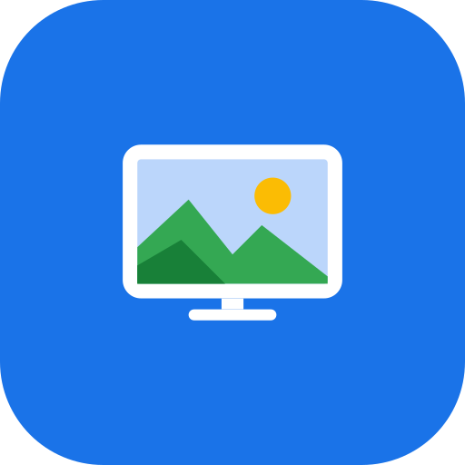

<div align="center">



# Foto TV

**Sfoglia le tue foto di Google Foto, anche degli album condivisi, sulla Fire TV Stick.**

Un'app Android TV che mostra sul televisore le foto che scegli dal telefono: griglia
navigabile con il telecomando, visore a schermo intero e presentazione automatica.

[](https://github.com/armando-basile/google-photos/actions/workflows/ci.yml)
[](https://github.com/armando-basile/google-photos/releases/latest)
[](https://github.com/armando-basile/google-photos/releases)
[](https://github.com/armando-basile/google-photos/commits/main)


[**Scarica l'ultimo APK**](https://github.com/armando-basile/google-photos/releases/latest) · [Funzioni](#funzioni) · [Come funziona](#come-funziona) · [Installazione](#installazione) · [Configurazione API Google](#configurazione-del-servizio-api-google-foto) · [Compilare dal sorgente](#compilare-dal-sorgente)

</div>

## Perché Foto TV?

La Fire TV Stick non ha l'app Google Foto e non ha i Google Play Services. Foto TV usa
l'API ufficiale **Google Photos Picker**: scegli foto e album dal telefono e l'app li
mostra sulla TV, senza digitare password con il telecomando.

- Nessun account o password da inserire sulla TV: basta inquadrare un codice QR.
- Funziona anche con gli **album condivisi**, perché la selezione avviene in Google Foto.
- Le foto scelte vengono salvate sulla TV e restano disponibili senza nuova selezione.
- Nessuna pubblicità, nessuna analisi d'uso, nessun server intermedio.

## Funzioni

- **Collegamento con QR code**: la TV mostra un codice, il telefono accede a Google e approva.
- **Selezione dal telefono** di foto e album tramite il Picker ufficiale di Google Foto.
- **Griglia** navigabile con il telecomando.
- **Visore a schermo intero** con frecce sinistra e destra, e **presentazione automatica** con OK.
- **Aggiungi, svuota e scollega** direttamente dall'app.
- **Aggiornamenti dalle release di GitHub**: controllo manuale o all'avvio, con verifica SHA-256 e della firma prima dell'installazione.
- Il token di accesso è salvato **cifrato** con l'Android Keystore.

## Come funziona

```
TV (Foto TV) ──QR──> Telefono ──> pagina di redirect (GitHub Pages) ──> Google (login)
      ^                                                                    │
      └──────────────── codice di autorizzazione, in rete locale ──────────┘
```

1. La TV avvia un piccolo server HTTP temporaneo sulla rete locale e mostra un QR code.
2. Il telefono apre la pagina in [`docs/`](docs/index.html), accede a Google e approva.
3. La pagina riporta il codice di autorizzazione alla TV, che lo scambia con i token (PKCE).
4. La TV mostra un secondo QR: dal telefono scegli le foto in Google Foto.
5. Le foto vengono scaricate in locale e mostrate nella galleria.

### Limiti dell'API di Google

Dal 31 marzo 2025 Google non permette più alle app di sfogliare l'intera libreria:
si possono mostrare solo le foto che l'utente sceglie con il Picker. Per questo l'app
importa la selezione invece di leggere l'intera libreria. I video non sono supportati.

## Installazione

1. Scarica `FotoTV-vX.Y.Z.apk` dall'[ultima release](https://github.com/armando-basile/google-photos/releases/latest).
2. Installalo sulla Fire TV Stick (per esempio con l'app **Downloader** o con `adb install`).
   Nelle impostazioni della Fire TV abilita *Installa app sconosciute* per l'app usata.
3. Apri **Foto TV**, inquadra il codice QR con il telefono e segui i passaggi.

Ogni release contiene anche un file `.sha256` per verificare il download:

```bash
sha256sum -c FotoTV-vX.Y.Z.apk.sha256
```

**Requisiti:** Fire OS 6 / Android 7.1 (API 25) o successivo, telefono e TV sulla stessa rete Wi-Fi.

### Aggiornamenti

Nella galleria apri **Impostazioni** per cercare una nuova versione con **Cerca aggiornamenti**, oppure attiva
**Controlla all'avvio**. Se esiste una release più recente l'app la scarica, verifica SHA-256, pacchetto, versione e firma,
poi la passa all'installer di sistema. Android chiede una volta il permesso *Installa app sconosciute* per Foto TV.

## Configurazione del servizio API Google Foto

Per leggere le foto scelte dall'utente, Google richiede un **client OAuth** registrato in un progetto Google Cloud.
Alla fine ottieni due valori: l'**ID client** e il **client secret**. La procedura è la stessa per lo sviluppatore e per chi
vuole usare l'app con le proprie credenziali, e si fa una volta sola dal computer (la console non è comoda da telefono o TV).

1. **Progetto.** Apri la [console Google Cloud](https://console.cloud.google.com/projectcreate), crea un progetto (per esempio *FotoTV*) e selezionalo.
2. **Abilita l'API.** Apri la pagina della [Google Photos Picker API](https://console.cloud.google.com/apis/library/photospicker.googleapis.com) e clicca **Abilita**.
3. **Schermata di consenso.** In [Google Auth Platform](https://console.cloud.google.com/auth/overview) clicca **Inizia** e inserisci nome dell'app e email di assistenza.
   In *Pubblico* scegli **Esterno**, aggiungi un'email di contatto, accetta i termini e crea.
4. **Ambito.** In **Accesso ai dati → Aggiungi o rimuovi ambiti** vai in fondo a *Aggiungi manualmente gli ambiti*, incolla
   ```
   https://www.googleapis.com/auth/photospicker.mediaitems.readonly
   ```
   e clicca **Aggiungi alla tabella**, poi **Aggiorna** e **Salva**.
5. **Utenti di test.** In **Pubblico → Utenti di test → Add users** aggiungi gli account Google che useranno l'app (fino a 100).
6. **Client OAuth.** In **Client → Crea client** scegli tipo **Applicazione web** e un nome a piacere. Lascia vuote le *Origini JavaScript autorizzate*.
   In **URI di reindirizzamento autorizzati** clicca *Aggiungi URI* e inserisci, con lo slash finale e identico:
   ```
   https://armando-basile.github.io/google-photos/
   ```
   Clicca **Crea**: compaiono **ID client** (finisce con `.apps.googleusercontent.com`) e **Client secret**.
   Copia subito il secret: Google potrebbe non mostrarlo di nuovo, e in quel caso se ne crea uno nuovo dalla pagina del client.
7. **Facoltativo: evitare la scadenza.** Finché lo stato resta *Testing*, il collegamento scade dopo 7 giorni. In **Pubblico → Pubblica app**
   passa a *In produzione*: non serve la verifica di Google, restano l'avviso "app non verificata" (Avanzate → Continua) e il limite di 100 utenti.

La pagina di reindirizzamento è statica, non contiene segreti e riceve l'ID client come parametro: puoi usare quella indicata sopra
anche per il tuo client, senza ospitare nulla. Se pubblichi un fork, attiva *Settings → Pages* sulla cartella `/docs` del ramo `main`
e imposta il tuo indirizzo in `PAIRING_PAGE_URL`.

### Dove inserire i due valori

- **Sulla TV (chi usa l'app):** **Impostazioni → Imposta credenziali dal telefono**, oppure **Usa le mie credenziali Google** nella schermata del QR.
  Inquadra il codice e incolla ID client e client secret nel modulo sul telefono: la TV ti chiederà di rifare il collegamento.
  I valori sono salvati cifrati sulla TV e il modulo viaggia solo sulla rete locale. **Ripristina predefinite** torna a quelli inclusi nell'app.
- **Compilando dal sorgente:** `GOOGLE_CLIENT_ID` e `GOOGLE_CLIENT_SECRET` in `local.properties` (vedi [Compilare dal sorgente](#compilare-dal-sorgente)).
- **Release su GitHub:** stessi nomi, come segreti dell'environment **Main** (vedi [Pubblicare una release](#pubblicare-una-release)).

### Problemi comuni

| Messaggio o sintomo | Causa e rimedio |
| --- | --- |
| `redirect_uri_mismatch` | L'URI nel client non coincide con la pagina usata: controlla lo slash finale e di averlo messo in *URI di reindirizzamento*, non nelle *Origini JavaScript*. |
| "Origine non valida: gli URI non devono contenere un percorso" | Hai inserito l'URL nel campo *Origini JavaScript autorizzate*: svuotalo e usa il campo degli URI di reindirizzamento. |
| `access_denied` o "l'app non ha completato la procedura di verifica" | L'account non è tra gli **utenti di test**: aggiungilo in *Pubblico*. |
| Dopo circa una settimana la TV chiede di nuovo il collegamento | Il progetto è in *Testing*: passa a *In produzione* (passo 7). |
| Errore 403 o "API not enabled" alla scelta delle foto | La Photos Picker API non è abilitata nel progetto del client (passo 2). |
| Il telefono non torna alla TV | Telefono e TV devono essere sulla stessa rete Wi-Fi e il router non deve isolare i dispositivi (*AP isolation*). |

## Compilare dal sorgente

Servono JDK 21 e l'Android SDK (piattaforma 36).

```bash
git clone https://github.com/armando-basile/google-photos.git
cd google-photos
```

Nel file `local.properties` (non versionato) imposta:

```properties
GOOGLE_CLIENT_ID=...
GOOGLE_CLIENT_SECRET=...
PAIRING_PAGE_URL=https://armando-basile.github.io/google-photos/
```

```bash
./gradlew assembleDebug
adb connect <ip-della-fire-tv>
adb install -r app/build/outputs/apk/debug/app-debug.apk
```

La build di release in locale è firmata con il keystore in `keys/` (non versionata): in `local.properties` imposta
`KEYSTORE_FILE`, `KEY_ALIAS`, `KEYSTORE_PASSWORD` e `KEY_PASSWORD`. Nella CI gli stessi valori arrivano dall'ambiente.
Senza la password del keystore un `assembleRelease` locale usa la chiave di debug.

### Pubblicare una release

Il push di un tag come `v1.2.3` avvia il [workflow di release](.github/workflows/release.yml),
che compila e firma l'APK e lo pubblica con il suo checksum. Nome e codice di versione derivano dal tag.

```bash
git tag v1.2.3
git push origin v1.2.3
```

Nell'environment **Main** del repository (Settings → Environments) servono questi segreti:
`ANDROID_KEYSTORE_BASE64`, `ANDROID_KEYSTORE_PASSWORD`, `ANDROID_KEY_ALIAS`, `ANDROID_KEY_PASSWORD`,
`GOOGLE_CLIENT_ID` e `GOOGLE_CLIENT_SECRET`. Conserva bene il keystore: un'app si aggiorna
solo con una build firmata con la stessa chiave.

> Il client secret finisce nell'APK pubblicato e va considerato non riservato.
> Per questo l'URI di reindirizzamento registrato nel client deve restare limitato alla pagina in `docs/`.

## Privacy

Foto TV non ha server propri: foto e token restano sulla TV, non ci sono pubblicità né analisi d'uso.
Leggi l'[informativa sulla privacy](https://armando-basile.github.io/google-photos/privacy.html) (italiano e inglese, sorgente in [docs/privacy.html](docs/privacy.html)).

## Tecnologie

Kotlin, Jetpack Compose for TV (Material 3), Coil, OkHttp, NanoHTTPD, ZXing, Google Photos Picker API,
GitHub Actions.

## Contribuire

Segnalazioni e idee sono benvenute: [apri una issue](https://github.com/armando-basile/google-photos/issues).
Le pull request avviano il workflow CI (build di debug).

## Parole chiave

Fire TV Stick, Android TV, Google Foto, album condivisi, photo frame, presentazione foto,
Google Photos Picker API, Jetpack Compose for TV.
